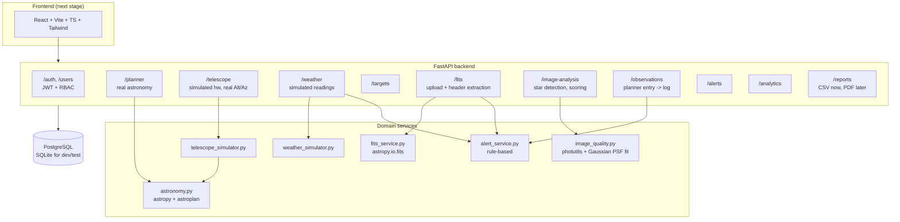

# ASTRA-OPS Architecture

Status: **backend core complete and tested** (57 automated tests passing).
Frontend, AI assistant, PDF reports, Docker, and the full top-level README
are the next stages — see [STATUS.md](STATUS.md) for exactly what's done
vs. pending.

## System overview

The one edge worth calling out: **`TelSim --> AstroSvc`**. The telescope
simulator has no real mount, but whenever it reports Alt/Az it asks the
real astronomy engine for the real answer, for whatever RA/Dec it's
(simulated to be) pointed at, at the real current time. That's the
project's "avoid fake implementations where a real calculation is
possible" rule applied literally.

## Module map (spec numbering -> implementation)

| # | Spec module | Where it lives | Status |
|---|---|---|---|
| 1 | Authentication | `core/security.py`, `api/routes/auth.py`, `api/routes/users.py` | Done |
| 2 | Observatory dashboard | frontend | Next stage |
| 3 | Observation planner | `services/astronomy.py`, `api/routes/planner.py` | Done |
| 4 | Target management | `models/target.py`, `api/routes/targets.py` | Done |
| 5 | Weather monitor | `services/weather_simulator.py`, `api/routes/weather.py` | Done |
| 6 | Telescope simulator | `services/telescope_simulator.py` + `telescope_interface.py` | Done |
| 7 | FITS data manager | `services/fits_service.py`, `api/routes/fits.py` | Done |
| 8 | Image quality analyzer | `services/image_quality.py`, `api/routes/image_analysis.py` | Done |
| 9 | AI observation assistant | — | Next stage (planned: Claude API, grounded in modules 3/7/8's real outputs) |
| 10 | Observation logging | `models/observation.py` (single row, planned -> logged) | Done |
| 11 | Report generation | `api/routes/reports.py` | CSV done; PDF next stage |
| 12 | Alert system | `services/alert_service.py`, `api/routes/alerts.py` | Done |
| 13 | Analytics | `api/routes/analytics.py` | Done |

## Key design decisions

**Real vs. simulated — the line, explicitly.** Per the brief's hardware
rule, here's the exact boundary:

| Data | Real or simulated | Why |
|---|---|---|
| Target Alt/Az, sun/moon position, illumination, visibility windows | **Real** — astropy/astroplan | This is pure orbital mechanics; there's no reason to fake it |
| Telescope Alt/Az while tracking/slewing | **Real** — computed from simulated RA/Dec via the same engine | See diagram note above |
| Telescope slewing/tracking/dome/camera state | **Simulated** | No physical mount exists yet; `TelescopeInterface` is the swap point for real hardware |
| Weather readings | **Simulated** | No sensor connected; `WeatherProvider` is the swap point; `WeatherRecord.source` always says so |
| FITS header metadata | **Real** — read from the uploaded file | Never inferred or defaulted |
| Star count / FWHM / SNR / background / saturation | **Real measurements** on the uploaded file's actual pixels | DAOStarFinder + Gaussian PSF fit + sigma-clipped stats, not placeholders |

**Astronomy precision tradeoff.** `astropy.utils.iers.conf.auto_download
= False` — this sandbox (and many deployments) shouldn't depend on a
live network call to an IERS bulletin server for basic planning-level
Alt/Az. Cost: pointing accuracy is at the arcsecond-to-sub-arcminute
level rather than sub-arcsecond. Irrelevant for "is this target above 30
degrees" but would need revisiting for precise go-to pointing against
real hardware.

**Image quality scoring is a documented rubric, not a black box** — see
the constants at the top of `services/image_quality.py`
(`FWHM_EXCELLENT_PX`, `SNR_EXCELLENT`, etc.) for every breakpoint. Total
score is always the exact sum of the five displayed sub-scores (rounded
before summing, not after) so it's manually auditable.

**Weather safety is worst-factor-wins**, not averaged — a single UNSAFE
factor (rain, high wind, high humidity, heavy cloud) makes the whole
reading UNSAFE. See the threshold table in
`services/weather_simulator.py`.

**JWT logout uses a process-local denylist**, not a real distributed
one. Documented in `core/security.py` as the one class to swap for
Redis/DB-backed revocation in a multi-worker deployment — the interface
(`revoke`/`is_revoked`) wouldn't need to change.

**Schema portability.** Models avoid Postgres-only types (no
JSONB/ARRAY) so the exact same schema runs on SQLite for fast tests and
Postgres in docker-compose. `Base.metadata.create_all()` on startup is a
convenience floor for "clone and run"; Alembic (`backend/alembic/`) is
the real migration path once there's live data to preserve — both exist
side by side deliberately.

**One `ObservationSession` row, not two tables.** A planner entry (spec
module 3) *becomes* the observation log entry (spec module 10) by
transitioning `status` from `planned` through `in_progress` to
`completed`/`failed`/`aborted`, rather than the planner writing to one
table and logging writing to another that then need to be kept in sync.

## Known simplification (documented, not hidden)

The telescope simulator freezes Alt/Az when `tracking=False` and not
slewing, rather than modeling the RA/Dec drift a truly stationary mount
would show. The physically-correct behavior (real Alt/Az via the
astronomy engine) always applies to the state that matters — actively
tracking. See the docstring in `services/telescope_simulator.py` for the
reasoning and the upgrade path (bidirectional AltAz<->ICRS transform).

The `/planner/currently-visible` endpoint reports pure geometric
altitude above the threshold, independent of whether it's currently
daylight at the site. That's an intentional, narrow definition ("is it
above the horizon by X degrees") — cross-referencing sun altitude to
flag "and it's currently dark" is a natural next enhancement, not
implemented yet.

## Testing philosophy

Astronomy and image-quality code can't be validated against a "does it
look right" gut check — the tests instead check either (a) physical
invariants that must hold regardless of the specific numbers (pole
altitude equals latitude; a target at zenith reads ~90 degrees), or (b)
recovery of known ground truth from synthetically generated data (a
star field built with a known PSF sigma, known background, known
injected saturation — see `tests/fixtures/synthetic_images.py`). Two
real bugs were caught this way during development: a photutils 3.0.0
column rename, and a sub-score rounding inconsistency — both are noted
in the relevant module's git history / commit-equivalent comments.
